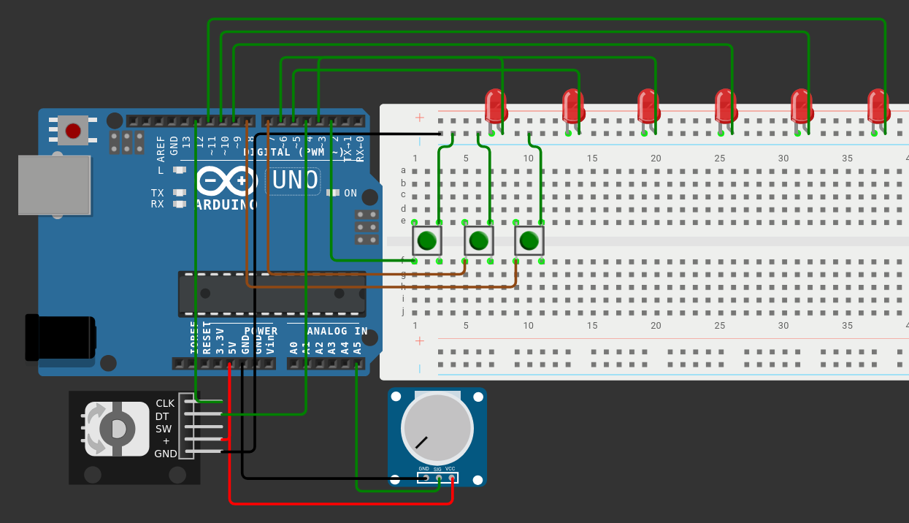

# LED Visualizer/Controller

Arduino Circuit Diagram

(you can try it in Wokwi): https://wokwi.com/projects/480497538766468097

## How it Works

Inputs
I used a rotary encoder (PinCLK/PinDT) to change the animation speed via the EnIndex1 array. There are three buttons: one to start the system and stop it, one to rotate the LED direction, and one to trigger the Turn all led except current. I also added a potentiometer on A5 to handle the brightness.

Animations
The "Fireball" effect moves a light across 6 LEDs. I used millis() instead of delay() so the app doesn't freeze and can still read the buttons. The "Fireshow" mode is a quicker, flashing sequence based on the current index.

The Technical Side
I used millis() to avoid blocking the code and worked on optimizing memory usage. This project gave me a lot of experience.
